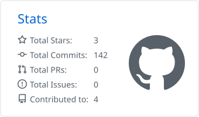
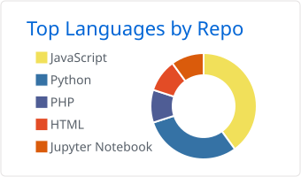

  <h1 align="center">Hey, I'm Yash Kumar Singh 👋</h1>

  

    
  

  

  
  
  
  

  ---

  ### 🧠 About me

  - 🤖 **AI Engineer** building **production GenAI systems** with Python and FastAPI.
  - ⚡ Shipped **LLM-powered microservices** (GPT-4o, Claude) that turn business data into structured, actionable tasks, with async pipelines on **Celery + Redis** running dozens of prompt templates in daily batches.
  - 🕸️ Built **GraphRAG**: hybrid retrieval over **Qdrant** vectors and a **Neo4j** knowledge graph for natural-language search over company knowledge.
  - 🛡️ I care about AI you can trust: **evaluation sets**, **code-side guardrails** that catch hallucinated outputs, tracing and failover.
  - ⚙️ Strong backend roots: multi-tenant **OAuth2/JWT** auth, rate limiting, and an API platform where I cut latency by **98%**.

  ---

  ### 🚀 Featured projects

  | Project | What it does | Stack |
  |---|---|---|
  | 🎙️ **[VoxDesk](https://github.com/yash6388/voxdesk)** | Multi-agent **voice AI platform for businesses**: answers customers from the business's own documents, books appointments through a custom **MCP** server, and hands off to staff. Supervisor and specialist agents talk over **A2A**. **86% Hit@1 · 100% routing · 5/5 faithfulness** on its eval suite. | LangGraph · A2A · MCP · Gemini · pgvector · FastAPI · Next.js · Whisper · Kokoro |
  | 📊 **[FilingLens](https://github.com/yash6388/FilingLens)** | **RAG over SEC 10-K filings** with cited answers and table-aware chunking. Hybrid retrieval (dense + BM25 → RRF) with cross-encoder **reranking**: **Hit@5 70% → 80%** on a hand-verified golden set. | LangGraph · Qdrant · Gemini · FastAPI · React |

  ---

  ### 🧰 Tech stack

  **GenAI & agents**

  

    
    
    
    
    
    
  
  
  
  
  
  

**Vector & graph databases**

  
  
  
  

**Backend · frontend · cloud**

  

---

### 📊 GitHub stats

  
  

---

<b>Let's build something intelligent. 🚀</b>

